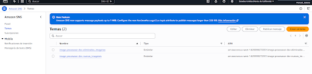
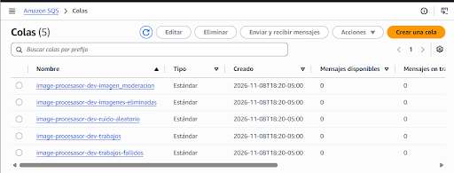
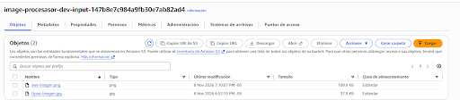
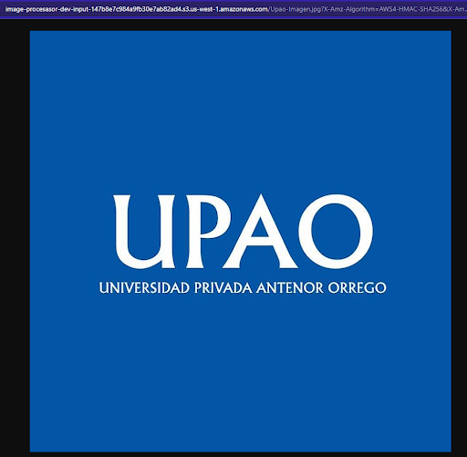
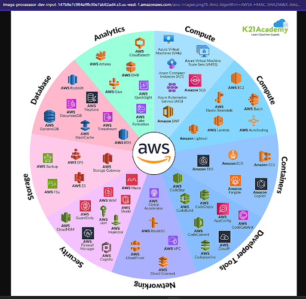
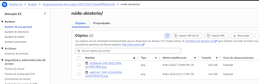

# Infraestructura - Tarea - Semana 10

El objetivo es comparar los casos de uso de Amazon SNS y Amazon SQS usando un flujo de práctica (distinto del proyecto del curso)

## Enunciado

Complementar con lo siguiente, enfocado en su proyecto:

1. ¿Qué problema resuelve cada servicio?
2. ¿Cuáles son sus tres beneficios principales? administración/costos/vendor lockin/curva de aprendizaje
3. ¿Qué diferencias existen en escalabilidad, disponibilidad?
4. ¿En qué escenario recomendaría el primer servicio y en cuál el segundo?
5. ¿Qué consecuencias técnicas o económicas tendría elegir el servicio incorrecto?
6. Evidencia de uso de cada servicio. Deben tener un despliegue donde se evidencie su servicio + forma de uso (pueden ser peticiones/registros/data). En caso de que el servicio requiera un complemento (ej. Load Balancer que necesita 2 o mas instancias para desplegar) deben tener provisionado y configurado el servicio complementario también. No es necesario que mantengan desplegado el servicio, una vez adjuntas las evidencias pueden eliminar los recursos.

## Objetivos

- Experimentar cómo SNS distribuye un evento a varios consumidores independientes
- Ver cómo SQS retiene trabajos, absorbe picos de carga y permite procesarlos gradualmente
- Hacer una comparación de los escenarios en los que conviene usar cada servicio (aún siendo casi complementarios)

## Componentes Terraform

Los archivos de infraestructura están en `iac/`.

| Archivo | Responsabilidad |
|---|---|
| `providers.tf` | Proveedores AWS y Archive; región y perfil configurados. |
| `variables.tf`, `locals.tf` | Variables y etiquetas comunes. |
| `s3_input.tf`, `s3_output.tf` | Buckets de entrada y salida. |
| `sns_nuevas_imagenes.tf` | Tema de imágenes nuevas y permiso de publicación de S3. |
| `sns_eliminadas_imagenes.tf` | Tema y suscripción de eventos de eliminación. |
| `sqs_imagen_moderacion.tf` | Cola, política, suscripción y mapeo al validador. |
| `sqs_ruido_aleatorio.tf` | Cola, política, suscripción y mapeo al worker. |
| `sqs_trabajos.tf` | Cola para mensajes directos y mapeo al worker. |
| `sqs_imagenes_eliminadas.tf` | Cola y mapeo de auditoría de eliminaciones. |
| `sqs_mensajes_fallidos.tf` | DLQ y política de redrive permitida. |
| `iam_rol_lambda_*.tf` | Roles y políticas IAM de las Lambdas. |
| `lambda_funcion_*.tf` | Funciones Lambda. |
| `lambda_paquete_*.tf` | Empaquetado ZIP de cada función. |
| `lambda/*.py` | Código de los handlers Python. |


## Componentes de AWS

### Amazon S3

Amazon S3 es un servicio de almacenamiento de objetos. En esta arquitectura, los buckets pueden guardar archivos de entrada y resultados de procesos asíncronos. S3 también puede publicar eventos  en un destino como SNS.

Se crearon dos buckets privados:

- `aws_s3_bucket.input`: recibe las iamegens y origina los eventos de creación y eliminación
- `aws_s3_bucket.output`: recibe los PNG con ruido que son generados por el worker

Ambos tienen un bloqueo de acceso público.

Una configuración básica de un bucket privado en Terraform:

```hcl
resource "aws_s3_bucket" "inpout" {
  bucket_prefix = "proyecto-xd"
}

resource "aws_s3_bucket_public_access_block" "input" {
  bucket= aws_s3_bucket.entrada.id
  block_public_acls       = true
  block_public_policy     = true
  ignore_public_acls      = true
  restrict_public_buckets = true
}
```

Para enviar eventos de creación a SNS, se configura una notificación en el bucket. El tema debe permitir que S3 publique en él:

```hcl
resource "aws_s3_bucket_notification" "eventos" {
  bucket = aws_s3_bucket.input.id

  topic {
    topic_arn = aws_sns_topic.eventos.arn
    events    = ["s3:ObjectCreated:*"]
  }

  depends_on = [
    aws_sns_topic_policy.permitir_s3
  ]
}
```

### Amazon SNS

Amazon SNS es un servicio de publicación y suscripción. Un productor publica un mensaje en un tema y SNS lo entrega a los destinos uscritos. Esto nos permite distribuir un evento a varios consumidores independientes.

En este proyecto se crearon los temas:

- `aws_sns_topic.nuevas_imagenes`: recibe eventos de creación de objetos desde S3 y los distribuye a las sqs suscritas
- `aws_sns_topic.eliminadas_imagenes`: recibe eventos de eliminación y los envía a su sqs suscrita.

Una configuración básica de un tema, una política que permite publicar eventos desde S3 y una suscripción SQS:

```hcl
resource "aws_sns_topic" "eventos" {
  name = "aplicacion-eventos"
}

resource "aws_sns_topic_policy" "permitir_s3" {
  arn = aws_sns_topic.eventos.arn

  policy = jsonencode({
    Version = "2012-10-17"
    Statement = [
      {
        Effect = "Allow"
        Principal = {
          Service = "s3.amazonaws.com"
        }
        Action   = "SNS:Publish"
        Resource = aws_sns_topic.eventos.arn
        Condition = {
          ArnLike = {
            "aws:SourceArn" = aws_s3_bucket.entrada.arn
          }
        }
      }
    ]
  })
}

resource "aws_sns_topic_subscription" "cola" {
  topic_arn = aws_sns_topic.eventos.arn
  protocol  = "sqs"
  endpoint  = aws_sqs_queue.procesamiento.arn

  depends_on = [
    aws_sqs_queue_policy.permitir_sns
  ]
}
```

### Amazon SQS

Es un servicio de colas que almacena mensajes hasta que un consumidor los procesa. La cola desacopla al productor del consumidor y permite controlar el ritmo del procesamiento. Una cola puede recibir mensajes desde SNS o directamente desde un productor.

Creamos las colas:

- `aws_sqs_queue.imagen_moderacion`: recibe una copia del evento de imágenes nuevas y activa el validador.
- `aws_sqs_queue.ruido_aleatorio`: recibe otra copia del evento y activa el worker.
- `aws_sqs_queue.trabajos`: recibe mensajes directos de prueba y activa el mismo worker.
- `aws_sqs_queue.imagenes_eliminadas`: recibe los eventos de eliminación y activa la Lambda de auditoría.
- `aws_sqs_queue.mensajes_fallidos`: DLQ para los mensajes que superan los intentos de procesamiento de la cola `trabajos`.

Una configuración básica de una cola principal, una DLQ, una política de reintentos y una política que permite a SNS publicar en la cola:

```hcl
resource "aws_sqs_queue" "fallidos" {
  name = "aplicacion-fallidos"
  message_retention_seconds = 1209600
}

resource "aws_sqs_queue" "procesamiento" {
  name= "aplicacion-procesamiento"
  visibility_timeout_seconds = 180
  message_retention_seconds  = 86400
  receive_wait_time_seconds  = 10

  redrive_policy = jsonencode({
    deadLetterTargetArn = aws_sqs_queue.fallidos.arn
    maxReceiveCount= 5
  })
}

resource "aws_sqs_queue_policy" "permitir_sns" {
  queue_url = aws_sqs_queue.procesamiento.id

  policy = jsonencode({
    Version = "2012-10-17"
    Statement = [
      {
        Effect = "Allow"
        Principal = {
          Service = "sns.amazonaws.com"
        }
        Action   = "sqs:SendMessage"
        Resource = aws_sqs_queue.procesamiento.arn
        Condition = {
          ArnEquals = {
            "aws:SourceArn" = aws_sns_topic.eventos.arn
          }
        }
      }
    ]
  })
}
```

El ejemplo de política para SNS solo se necesita cuando un tema SNS envía mensajes a la cola. El tiempo de visibilidad debe permitir que el consumidor termine de procesar el mensaje; para una cola consumida por Lambda, AWS recomienda al menos seis veces el timeout de la función. 

#### Métricas de SQS en CloudWatch

SQS publica automáticamente métricas en CloudWatch. Las métricas de cantidad de mensajes son aproximadas, así que resultan más útiles para observar tendencias y carga que para llevar un conteo exacto.

| Métrica | Qué permite observar |
|---|---|
| `ApproximateNumberOfMessagesVisible` | Mensajes disponibles para procesar; un aumento sostenido puede indicar acumulación. |
| `ApproximateNumberOfMessagesNotVisible` | Mensajes recibidos que todavía están en proceso o bajo el tiempo de visibilidad. |
| `ApproximateAgeOfOldestMessage` | Antigüedad del mensaje pendiente más antiguo; permite observar retrasos. |
| `NumberOfMessagesSent` | Actividad de entrada a la cola. |
| `NumberOfMessagesReceived` | Actividad de lectura por los consumidores; un mensaje puede recibirse más de una vez. |
| `NumberOfMessagesDeleted` | Eliminaciones realizadas después del procesamiento. |

Para supervisar una DLQ, `ApproximateNumberOfMessagesVisible` indica si hay mensajes fallidos pendientes de inspección.

### AWS Lambda

AWS Lambda ejecuta código sin que sea necesario administrar servidores. Puede procesar mensajes de una cola SQS mediante un *event source mapping*

En este proyecto se crearon estas funciones:

- `aws_lambda_function.trabajos`: genera un PNG con ruido aleatorio y lo guarda en S3. Está conectada a las colas `trabajos` y `ruido_aleatorio`.
- `aws_lambda_function.validador_imagenes`: valida la extensión de los objetos recibidos y registra el resultado.
- `aws_lambda_function.auditoria_eliminaciones`: registra los datos de los eventos de eliminación.

Una configuración Terraform básica de una función y su conexión con una cola:

```hcl
resource "aws_lambda_function" "consumidor" {
  function_name = "aplicacion-consumidor"
  role          = var.lambda_role_arn
  runtime       = "python3.12"
  handler       = "procesador.handler"

  filename         = "${path.module}/lambda.zip"
  source_code_hash = filebase64sha256("${path.module}/lambda.zip")

  timeout     = 30
  memory_size = 128
}

resource "aws_lambda_event_source_mapping" "cola" {
  event_source_arn = aws_sqs_queue.procesamiento.arn
  function_name    = aws_lambda_function.consumidor.arn
  batch_size       = 1
  enabled          = true
}
```

El rol de ejecución de la función debe confiar en Lambda y contar con los permisos que necesita: por ejemplo, recibir y eliminar mensajes de la cola, escribir logs o acceder a S3. En el ejemplo, `var.lambda_role_arn` representa un rol que ya debe estar definido.

### Métricas de SNS en CloudWatch

SNS publica automáticamente métricas en el namespace `AWS/SNS`. En este proyecto se consideran las siguientes para observar la publicación y distribución de eventos. 

| Métrica | Qué permite observar |
|---|---|
| `NumberOfMessagesPublished` | Mensajes publicados en un tema. |
| `NumberOfNotificationsDelivered` | Notificaciones que SNS entregó correctamente a sus suscriptores. |
| `NumberOfNotificationsFailed` | Notificaciones que SNS no pudo entregar. |

La comparación entre mensajes publicados y entregados permite verificar la distribución. Un valor de fallos puede indicar problemas con el endpoint, la suscripción o sus permisos.

CloudWatch Logs también almacena los registros escritos por las Lambdas. Las métricas de SNS y SQS se publican automáticamente; crear alarmas o enviar avisos por correo requiere configuración adicional. En esta infraestructura no se han definido alarmas ni dashboards personalizados.


## Requisitos

- Terraform instalado.
- AWS CLI instalado para enviar trabajos de prueba.
- Una cuenta de AWS y credenciales locales con permisos para crear los recursos.


## Despliegue

Desde la raíz del repositorio:

```bash
cd iac
terraform init
terraform validate
terraform plan
terraform apply
```

Revisa el plan antes de aplicar. La configuración crea recursos en AWS que pueden generar cargos.

## Evidencias para la presentación

- Carga de una imagen en S3 y registro de `ObjectCreated`.
- Métricas de SNS que muestren mensajes publicados y entregados.
- Mensajes visibles o procesados en las colas SQS suscritas.
- Logs del validador y del auditor en CloudWatch Logs.
- Mensajes enviados a `trabajos`, invocaciones de Lambda y PNGs creados en el bucket de salida.
- Configuración de redrive entre `trabajos` y la DLQ.

## Limpieza

Antes de destruir la infraestructura, vacía los buckets S3 de entrada y salida. Luego, desde `iac/`, ejecuta:

```bash
terraform destroy
```

## Evidencias

### 1. Evidencia de la creación de los SNS



### 2. Evidencia de la creación de los SQS

## Fuentes de información

### 3. Evidencia de la creación del Bucket Input


### 3.1. Ejemplo de imagen en el Input


### 3.2. Ejemplo de imagen en el Input


### 3. Evidencia de la creación del Bucket Outpout


### 3.1. Ejemplo de imagen en el Output


### 3.2. Ejemplo de imagen en el Output


### 4. Métricas SNS


### 5. Métricas SQS


## Fuentes de información

1. [Amazon SNS](https://docs.aws.amazon.com/sns/latest/dg/welcome.html)
2. [Métricas de Amazon SNS](https://docs.aws.amazon.com/sns/latest/dg/sns-monitoring-using-cloudwatch.html)
2. [Amazon SQS con Lambda](https://docs.aws.amazon.com/lambda/latest/dg/services-sqs-configure.html)
3. [Amazon SQS](https://docs.aws.amazon.com/AWSSimpleQueueService/latest/SQSDeveloperGuide/welcome.html)
3. [Métricas disponibles de SQS](https://docs.aws.amazon.com/AWSSimpleQueueService/latest/SQSDeveloperGuide/sqs-available-cloudwatch-metrics.html)
